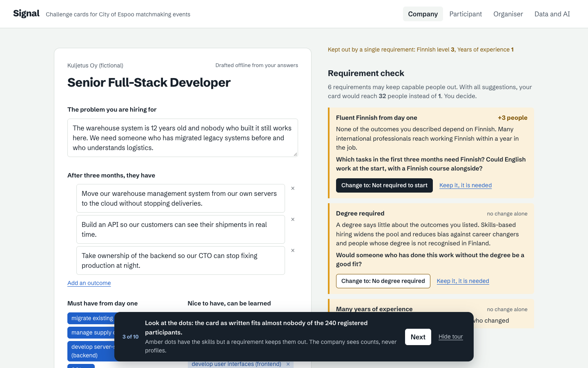

# Signal: challenge cards for Espoo matchmaking events

**Live demo: https://arska251.github.io/signal-espoo/** (opens with a guided tour, about four minutes)

Junction 2026 submission for the City of Espoo challenge "Rethinking Recruitment". What it does and why: [SUBMISSION.md](SUBMISSION.md).

A hiring manager answers three questions in their own words. Signal turns them into a challenge card, shows right away how many registered event participants fit it, and points out the requirements that keep capable people out. Participants answer one of the company's outcomes in a few sentences instead of sending a CV; companies read the answers unranked and without names, and book 15-minute meetings with three conversation questions for each side.

All participant data is synthetic. The public demo drafts cards with keyword rules; with an Anthropic API key on the dev server, Claude drafts them.



## Run locally

```bash
npm install
npm run dev     # http://localhost:5173
npm test        # unit tests for the matching engine
```

To draft cards with Claude, put `ANTHROPIC_API_KEY=...` in `.env` and restart `npm run dev`. The key stays on the dev server (`vite.config.ts` mounts `POST /api/card`, which calls `server/claude.ts`).

## Where things are

| Path | What |
| --- | --- |
| `src/data/skills.ts` | ESCO-style skills taxonomy with related skills and extraction keywords |
| `src/data/pool.ts` | 240 synthetic participants from a fixed seed |
| `src/engine/match.ts` | Rule-based matching: strong, close, kept out by a requirement |
| `src/engine/flags.ts` | Requirement check and the "relax" suggestions |
| `src/engine/extractLocal.ts` | Offline card drafting |
| `src/engine/interests.ts` | Interests, seeded answers, conversation brief |
| `server/claude.ts` | Claude drafting with structured output |
| `src/components/` | Describe, Review, Published, Inbox, Participant, Organiser, Tour, About |
